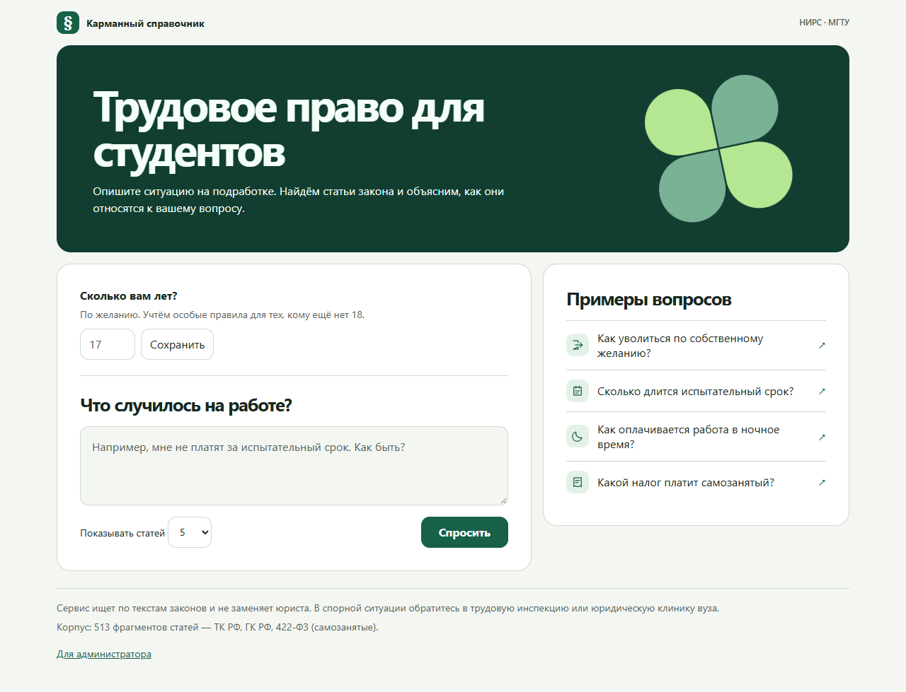

# Трудовое право для студентов

Веб-приложение для студентов, которые подрабатывают параллельно с учёбой.
Студент описывает ситуацию своими словами («не платят за испытательный срок»,
«не отпускают на сессию») и получает короткий ответ простым языком со ссылками
на статьи Трудового кодекса, Гражданского кодекса (договоры подряда и услуг)
и закона о самозанятых. Поиск — собственный индекс BM25, ответ — языковая
модель по найденным статьям (RAG).

НИРС по курсу ОАД, МГТУ им. Н. Э. Баумана, кафедра ИУ5, 2026.



## Запуск

Нужен Python 3.10+. Для лемматизации поставьте `pymorphy3` — без неё приложение
тоже запустится, но с встроенным стеммером (поиск чуть хуже):

```bash
pip install -r requirements.txt
```

```bash
python -m app            # http://127.0.0.1:8000
python -m app --port 9000
```

### Языковая модель

Ответ формирует LLM через OpenAI-совместимый API (YandexGPT, Ollama, DeepSeek,
OpenRouter и др.). Скопируйте `.env.example` в `.env` и раскомментируйте один
вариант — ключ хранится только в `.env`, он в `.gitignore`. Без настройки
приложение работает с ответом-заглушкой (метка «прототип»), поиск — тот же BM25.
При старте сервер пишет, какая модель подключена.

Страница администратора — `http://127.0.0.1:8000/admin`. Токен берётся из
`ADMIN_TOKEN` (переменная окружения или файл `.env` в корне); если не задан,
сервер печатает случайный токен в консоль при старте.

```bash
echo ADMIN_TOKEN=придумайте-длинный-токен > .env
```

Аналитика пишется в `data/analytics.sqlite3` (путь меняется `ANALYTICS_DB`) и
не содержит текстов вопросов — см. [spec/tech/admin.md](spec/tech/admin.md).

Корпус `data/corpus.jsonl` уже собран. Пересобрать:

```bash
python scripts/fetch_laws.py     # нужен npm; выгружает тексты законов в data/raw/
python scripts/build_corpus.py   # статьи -> data/corpus.jsonl
```

## Основной сценарий

Описание ситуации → найденные статьи → ответ со ссылками «ст. N ТК РФ» и оговоркой,
что это не юридическая консультация. Если пользователь указал возраст младше 18 лет,
ответ дополняется нормами для несовершеннолетних (С6). Администратор смотрит
обезличенную аналитику на `/admin` (С7). Подробно: [spec/product/scenarios.md](spec/product/scenarios.md).

## Проверка

```bash
python -m unittest -v          # тесты API, поиска, возраста, админки
python -m benchmark.run        # Recall@5/10, MRR, отказы на ловушках, разбор ошибок
python -m benchmark.run --grid # сравнение нормализации, расширения запроса, k1 и b
python -m benchmark.run --llm  # + ответы модели: Accuracy и отказы LLM на ловушках
```

Benchmark можно запустить и в работающем приложении: `/admin` → «Benchmark поиска».
Итоги КТ2: Recall@5 0,41, Recall@10 0,54, MRR@10 0,77, отказ на 4 из 6 ловушек —
подробно в [spec/tech/rag.md](spec/tech/rag.md).

## Структура

```
README.md            запуск и сценарий
AGENTS.md            правила работы с репозиторием (для людей и кодинг-агента)
CHANGE_HISTORY.md    история изменений по контрольным точкам
spec/product/        пользователь, задача, сценарии, интерфейс
spec/tech/           архитектура, API, RAG и BM25, способ проверки
app/                 сервер, поиск BM25 (retrieval/), конвейер ответа (rag.py),
                     вызов LLM (llm.py) и заглушка, возраст (age.py),
                     аналитика (analytics.py), интерфейс и админка (static/)
data/raw/laws.jsonl  тексты статей: ТК РФ, ГК РФ (подряд, услуги), 422-ФЗ
data/corpus.jsonl    корпус: 513 документов
scripts/             выгрузка законов, разбор актуальной редакции, сборка корпуса
tests/               тесты API, поиска, возраста и админки
benchmark/           тестовые запросы, расчёт метрик, результаты (results/)
docs/                распределение работы, материалы к КТ1, бриф редизайна
```

## Данные

Тексты законов — из открытого набора `@ansvar/russian-law-mcp` (Apache-2.0,
источник — pravo.gov.ru). Тексты законов не являются объектом авторского права
(п. 6 ст. 1259 ГК РФ). В наборе ранние редакции; на КТ2 заменяем на актуальные.

## Команда

См. [docs/team.md](docs/team.md).
